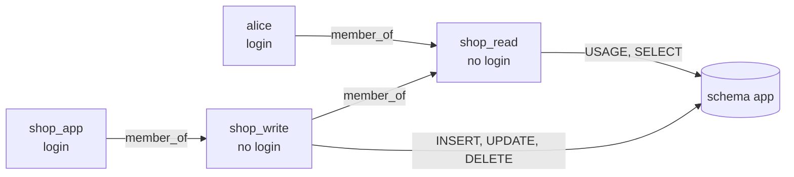

# Manage access with group roles

After this you grant privileges once to a group role, and give people and services access by
adding them to the group instead of granting to each of them.

## When you need this

Several login roles need the same access: three analysts read the `shop` database, two
services write to it. Granting to each login role repeats the same grant block per role, and
a new colleague means copying it again. With group roles, the grants stay in one place and
access becomes a one-line `member_of` entry.

## What you need to know first

- **Group role.** A role with `login: false` that holds privileges. Members of the group
  use its privileges. See [Role membership](https://www.postgresql.org/docs/current/role-membership.html).
- **`member_of`.** Lists the roles a role becomes a member of. The provisioner runs
  `GRANT "<group>" TO "<role>"` for each entry that isn't granted yet. See
  [Role memberships](../configuration.md#role-memberships).
- **`inherit`.** A member with `inherit: true` (PostgreSQL's default) uses the group's
  privileges directly. With `inherit: false`, it has to `SET ROLE` to the group first.

This is the structure the steps build: grants go to the two groups, login roles only join them.



## Steps

The names `shop`, `app`, `shop_read`, `shop_write`, `alice` and `shop_app` are examples;
replace them with your own.

### 1. Declare the group roles

Groups are roles without login and without a password. `shop_write` is a member of
`shop_read`, so writers can also read.

```yaml
roles:
  - name: shop_read                 # group: read access, cannot log in
    options:
      login: false
  - name: shop_write                # group: write access, plus everything shop_read has
    options:
      login: false
    member_of: [shop_read]
```

### 2. Grant to the groups, not to people

Every grant names a group. The `on_tables_in_schema` grants also set default privileges, so
tables created later are covered too.

```yaml
databases:
  - name: shop
    schemas:
      - name: app
    grants:
      - role: shop_read
        privileges: [USAGE]
        on_schema: app
      - role: shop_read
        privileges: [SELECT]
        on_tables_in_schema: app
      - role: shop_write
        privileges: [INSERT, UPDATE, DELETE]
        on_tables_in_schema: app
      - role: shop_write
        privileges: [USAGE]
        on_sequences_in_schema: app
```

### 3. Add login roles to the groups

Login roles carry only credentials and memberships. Add them under `roles:`, next to the groups:

```yaml
  - name: alice
    password: ${ALICE_PASSWORD}
    options:
      login: true
    member_of: [shop_read]
  - name: shop_app
    password: ${SHOP_APP_PASSWORD}
    options:
      login: true
    member_of: [shop_write]
```

The provisioner grants memberships in a separate pass after all roles exist, so the order of
entries in `roles` doesn't matter. Circular memberships are rejected when the config loads,
for example
`roles[1].member_of[0]: circular role membership shop_read -> shop_write -> shop_read`.

## Check that it works

List the memberships as the admin user (psql 16 or later):

```console
$ psql -h localhost -U admin -d shop -c '\drg'
              List of role grants
 Role name  | Member of  |   Options    | Grantor
------------+------------+--------------+---------
 alice      | shop_read  | INHERIT, SET | admin
 shop_app   | shop_write | INHERIT, SET | admin
 shop_write | shop_read  | INHERIT, SET | admin
```

Then try the access itself:

```console
$ psql -h localhost -U alice -d shop -c "SELECT count(*) FROM app.orders"
$ psql -h localhost -U alice -d shop -c "DELETE FROM app.orders"
ERROR:  permission denied for table orders
```

On a re-run, the provisioner logs `Role membership already granted, skipping` for each one.

## Pitfalls

- **Removing `member_of` keeps the membership.** The provisioner never revokes memberships
  (see [Additive by design](../concepts.md#additive-by-design)). Revoke by hand as the admin
  user: `REVOKE "shop_read" FROM "alice";`.
- **`permission denied` for a member with `inherit: false`.** It must run
  `SET ROLE shop_read;` before using the group's privileges.
- **Changing `inherit` later has no effect on PostgreSQL 16+.** The membership's `INHERIT`
  option is fixed when granted. Fix it with `GRANT "shop_read" TO "alice" WITH INHERIT TRUE;`,
  or revoke and re-run.
- **`strategy: create` skips memberships of existing roles.** A new `member_of` entry on a
  role that already exists is ignored and logged as
  `Skipping memberships for existing role (strategy=create)`.
- **Group missing:** a `member_of` entry need not be declared in `roles` (predefined roles
  such as `pg_monitor` never are), so a typo only fails when the `GRANT` runs.

## Further reading

- [Role memberships](../configuration.md#role-memberships) in the configuration reference,
  including the privileges a non-superuser admin needs on PostgreSQL 16+.
- [Create read-only users](read-only-users.md) for the grant levels a read group can use.
- [Role membership](https://www.postgresql.org/docs/current/role-membership.html) in the
  PostgreSQL documentation.
